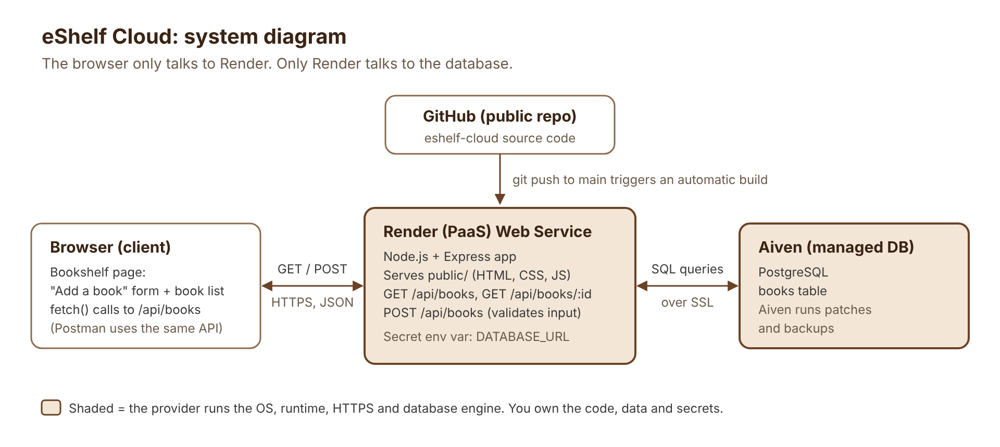

# eShelf Cloud

A cloud version of the eShelf library catalog, built for the IT 412 Platform Technologies final project.

- **Live app:** https://eshelf-cloud.onrender.com
- **Hosting (PaaS):** Render Web Service (Node.js)
- **Database:** Aiven for PostgreSQL (managed, free tier)
- **Backend:** Node.js + Express
- **Frontend:** HTML, CSS and vanilla JavaScript, styled after the original eShelf

Users add books through a form, then borrow and return copies from the catalog. The browser sends every action to the Express API, which validates it, applies the library rules (you can't borrow when no copies are left, or return more copies than the library owns) and stores the result in the cloud database. The book list is read back from the database, so it survives page refreshes and app restarts.



## API

| Method | Route             | Success                   | Errors                                    |
|--------|-------------------|---------------------------|-------------------------------------------|
| GET    | `/api/books`      | `200` + array of books    | `500` database error                      |
| GET    | `/api/books/:id`  | `200` + one book          | `400` invalid id, `404` not found         |
| POST   | `/api/books`      | `201` + the created book  | `400` missing/invalid fields or bad JSON  |
| POST   | `/api/books/:id/borrow` | `200` + the book, one fewer copy available | `409` no copies left, `404` not found, `400` invalid id |
| POST   | `/api/books/:id/return` | `200` + the book, one more copy available  | `409` all copies already returned, `404` not found, `400` invalid id |

POST body (JSON):

```json
{
  "title": "Noli Me Tangere",
  "author": "Jose Rizal",
  "category": "Classic",
  "isbn": "978-971-0-12345-6",
  "copies": 3
}
```

`title` and `author` are required. `category`, `isbn` (10 or 13 digits, dashes allowed) and `copies` (1 to 100, default 1) are optional.

A Postman collection with all test requests is in [`postman/`](postman/). Import it, set the `baseUrl` variable to the live URL, and run it.

## Run locally

Requires Node.js 18 or newer.

1. `npm install`
2. Copy `.env.example` to `.env` and paste your Aiven Service URI as `DATABASE_URL`.
3. Put the Aiven CA certificate in the project root as `ca.pem`.
4. `npm run dev`, then open http://localhost:3000

The app creates the `books` table on startup.

## Deploy on Render

New → Web Service → this repo. Build command `npm install`, start command `npm start`, instance type Free. Add `DATABASE_URL` under Environment. Every push to `main` redeploys automatically.

## Project structure

```
├── public/          Frontend (index.html, style.css, app.js)
├── postman/         Postman collection for the API tests
├── docs/            System diagram
├── server.js        Express app and API routes
├── db.js            PostgreSQL connection (SSL with ca.pem)
├── ca.pem           Aiven CA certificate (public, safe to commit)
├── .env.example     Template for the DATABASE_URL secret
└── package.json
```
